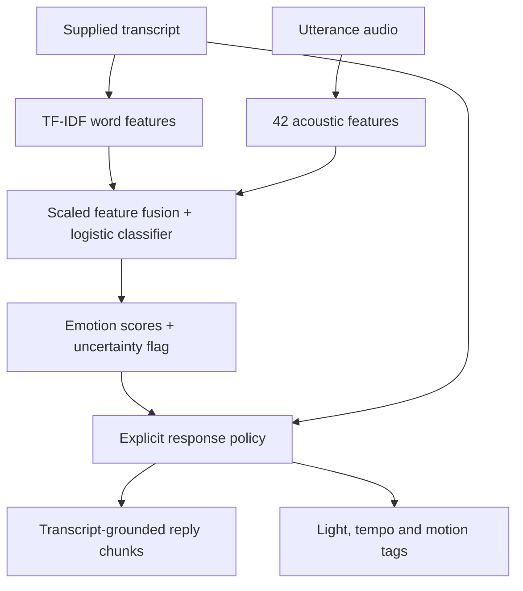

# Multimodal robot interaction

A local text-and-audio prototype for emotion-aware character robot interactions, built for the Human Computer Lab ML challenge.

A MELD utterance travels through transcript features and acoustic features into a seven-class emotion estimate. An explicit response policy produces a short reply grounded in the transcript plus light, tempo and motion tags. A local browser demo shows those tags on a simulated character and streams the reply over a WebSocket.

**Primary track assumption:** text, supported by audio. The assignment's track wording is ambiguous. This submission implements two input modalities end to end. Vision is played for human review in the interface.

## Run

Use Python 3.12 and install [FFmpeg](https://ffmpeg.org/download.html) so `ffmpeg -version` works in your terminal. Create and activate a virtual environment, then run these commands from the repository root.

```bash
python -m pip install -r requirements-lock.txt
python -m pip install -e . --no-deps

# Supplied trained artifact, immediate text-path smoke check
python -m robot_interaction.demo --mode text --text "I finally finished my project!"

# Fetch official transcripts and the 10.9 GB media archive, then extract clips
python scripts/prepare_data.py

# Replay actual multimodal turns, one JSON result per turn
python -m robot_interaction.demo --split dev --dialogue 0

# Interactive replay and modality comparison
python -m uvicorn robot_interaction.server:app --host 127.0.0.1 --port 8000
```

Open [the local demo](http://127.0.0.1:8000). Select a turn, play its clip, then press **Process this turn**. Change the model to **Text only** and process the same turn again. **Replay conversation** plays and processes turns in order. You can stop replay after the current turn. The server processes each socket's requests sequentially and serializes inference across clients.

You can also supply your own audio and transcript without downloading MELD.

```bash
python -m robot_interaction.demo --text "Your transcript here" --audio /path/to/speech.wav
```

The caller supplies the transcript and turn boundaries. Audio is decoded locally, converted to mono 16 kHz, and capped at 60 seconds. Current predictions use only the current turn. The replay retains interaction history for review.

## Demonstration

1. Run the browser demo and replay development dialogue 0. A recorded JSON replay is included in `reports/demo.jsonl`. Show the spoken input, transcript, estimated emotion, reply and structured state.
2. Reprocess a turn with text only and then text plus audio. Inspect the seven scores as well as the winning label. Audio can change a score even when the winning label stays the same.
3. Show a low-confidence turn. The robot asks how the speaker feels and adopts an attentive behavior. The fixed threshold is an interaction heuristic. Scores are uncalibrated.
4. Open `reports/evaluation.json` and `reports/benchmark.json` to substantiate accuracy, latency, resource use and the parameter budget. Review the example successes and mistakes in `reports/case_studies.json`.

## Design



Text uses unigram/bigram TF-IDF fitted on training data. Audio uses MFCC means and standard deviations, energy, zero crossings, spectral centroid, flatness, duration and autocorrelation pitch summaries. These are deterministic features with zero learned backbone parameters. Training-fitted scaling puts acoustic features on comparable scales. Early fusion concatenates the sparse text vector with weighted acoustic features. The audio weight is chosen from four predefined values on development macro-F1.

Small logistic classifiers make the full local path understandable and practical on a CPU. Three models support ablation in the same demo. The reply policy quotes an excerpt of the actual transcript and chooses an emotion-sensitive prompt, or a clarification prompt below score 0.4. This provides limited grounding and predictable behavior. Response quality has no human evaluation. Streaming sends a completed template as ordered word chunks, with no artificial typing delay.

## Evidence and reproducibility

| Model | Test macro-F1 | Test accuracy |
| --- | ---: | ---: |
| Majority | 0.0928 | 0.4812 |
| Text | 0.3076 | 0.4004 |
| Audio | 0.1893 | 0.2299 |
| Fusion | 0.3317 | 0.4303 |

Evaluated on **2,610 test turns**, with **9,988 training** and **1,108 development turns**. One train clip failed decoding and one development clip was absent from the archive. No test turns were excluded.

The selected fusion weight is **0.03**. Audio increased test macro-F1 by **2.41 percentage points**. This modest increase is evidence for this configuration on this split.

On an **AMD EPYC 9V45 96-Core Processor**, with **9 available logical CPUs** and **9.73 GiB reported system memory**, the combined path had **66.7 ms p50** and **97.9 ms p95** over the first 100 usable test turns. BLAS was restricted to one thread. No GPU was used. Observed peak RSS across the benchmark process and its child decoder was **186.6 MiB**, sampled every 10 ms. Model startup took **73.4 ms**, measured separately.

All three classifiers and retained preprocessing statistics total **155,715 numeric learned values**, counting all models available in the demo. The artifact is **1.15 MiB**. The complete inventory is in the benchmark report.

All models use the same available-audio intersection within the official train/development/test split. TF-IDF vocabulary/IDF and acoustic normalization are fitted exclusively on training data. The four audio weights are selected using development data. Test labels are used for final scoring and post-hoc case studies. Cases are illustrative and include successes and regressions. The majority baseline is selected using the training majority class.

Macro-F1 gives each emotion equal weight, which matters for MELD's class imbalance. Accuracy and weighted F1, per-class metrics and confusion matrices are also recorded. This is one experiment with a fixed configuration and no significance claim. The benchmark reports warm sequential inference and separates startup from per-turn processing.

To reproduce training and measurements after preparing the media:

```bash
python scripts/extract_features.py
python -m robot_interaction.train
python scripts/benchmark.py --turns 100
python scripts/case_studies.py
python -m unittest discover -s tests -v
```

**Validation:** six automated checks passed, covering finite acoustic features, invalid inputs, cached/online preprocessing agreement, parameter count, WebSocket event order and recovery. JavaScript syntax checks passed. Browser rendering was not verified in this execution environment because Chromium could not launch under its process restrictions.

`reports/data_manifest.json` records missing and failed clips per split. `reports/provenance.json` records source URLs, file checksums, dependency versions and the random seed. Feature caches and source media are excluded from Git. The supplied `artifacts/model.joblib` includes the fitted preprocessing and classifiers. Load only the distributed artifact or one you trained yourself.

**Real-time definition:** a target of 500 ms from a completed, presegmented turn available locally to structured state plus the complete reply. The measured path includes FFmpeg decoding, audio features, text transform, classification and policy. It excludes speech duration, automatic transcription, turn detection, model startup, socket/network/browser overhead and request queuing. `server_elapsed_ms` includes server queue wait plus inference. This is a turn-based interaction prototype. See the observed distribution and hardware in the benchmark report.

## Scope and limitations

Completed components include MELD ingestion, training-only preprocessing, modality ablations, local inference, ordered JSON/WebSocket output, a transcript-grounded template response, robot behavior tags, a local interactive simulation and measured evaluation/resource reports.

Vision inference, microphone capture, automatic transcription, physical robot integration, multi-turn context modeling, reinforcement learning, open-ended language generation and calibrated uncertainty are left for future iterations. Video playback in the demo helps the reviewer inspect the input. The classifier infers dataset labels from text and audio.

MELD contains acted sitcom conversations, background music, audience laughter and multiple speakers. Acoustic features can capture these confounds. A clip may contain someone other than the intended speaker. Text TF-IDF loses word order beyond bigrams and handles sarcasm and context poorly. Official splits do not establish generalization to new users, everyday robot settings or languages. An emotion estimate requires user interpretation, and the policy's clarification behavior is a heuristic with no measured interaction benefit. The interface displays MELD annotations only for review. Labels are never passed to inference.

The source checkout is the supported execution layout. The prototype is intended for local, single-user use on loopback.

## External and AI-generated components

- [MELD project](https://affective-meld.github.io/) and [official source repository](https://github.com/declare-lab/MELD) supply the transcripts, emotion annotations and media. Data is downloaded from the official University of Michigan mirror. Consult their terms for dataset/media use.
- Scikit-learn supplies TF-IDF, scaling and logistic regression. NumPy/SciPy implement deterministic signal processing. FFmpeg decodes media. FastAPI/Uvicorn serve the local interface.
- OpenAI Codex assisted with implementation, experiment execution, the interface and documentation. The included results come from the recorded local experiment. The applicant should review the code, rerun the demo and be prepared to modify and explain these decisions before submission.

MELD reference: Poria et al., *MELD: A Multimodal Multi-Party Dataset for Emotion Recognition in Conversations*, ACL 2019. [Paper](https://aclanthology.org/P19-1050/).
